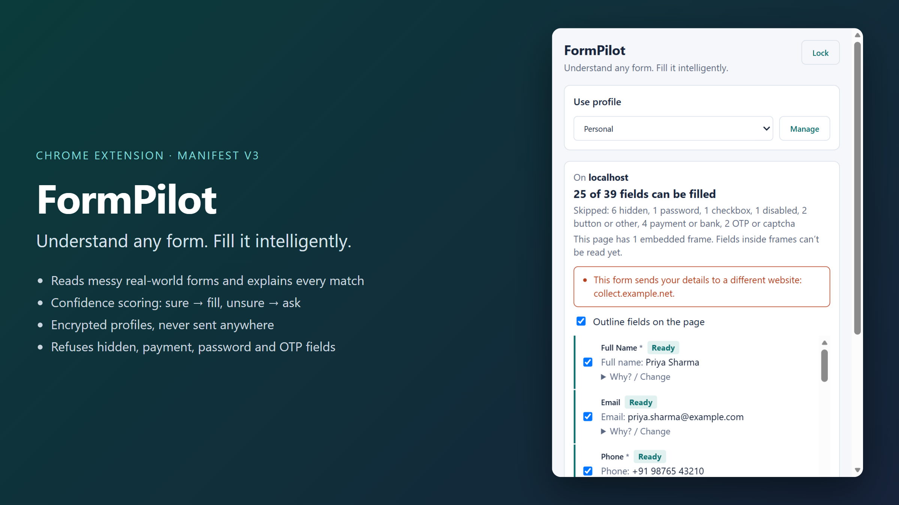
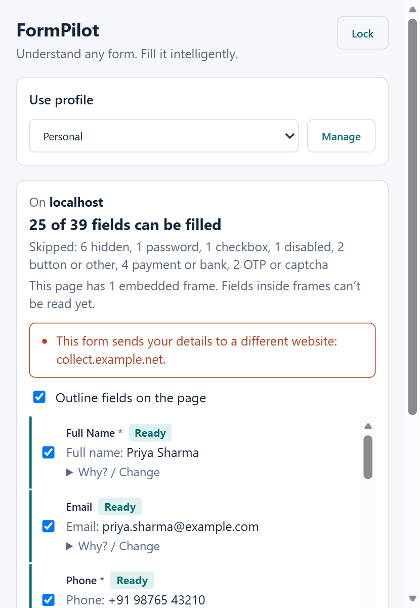
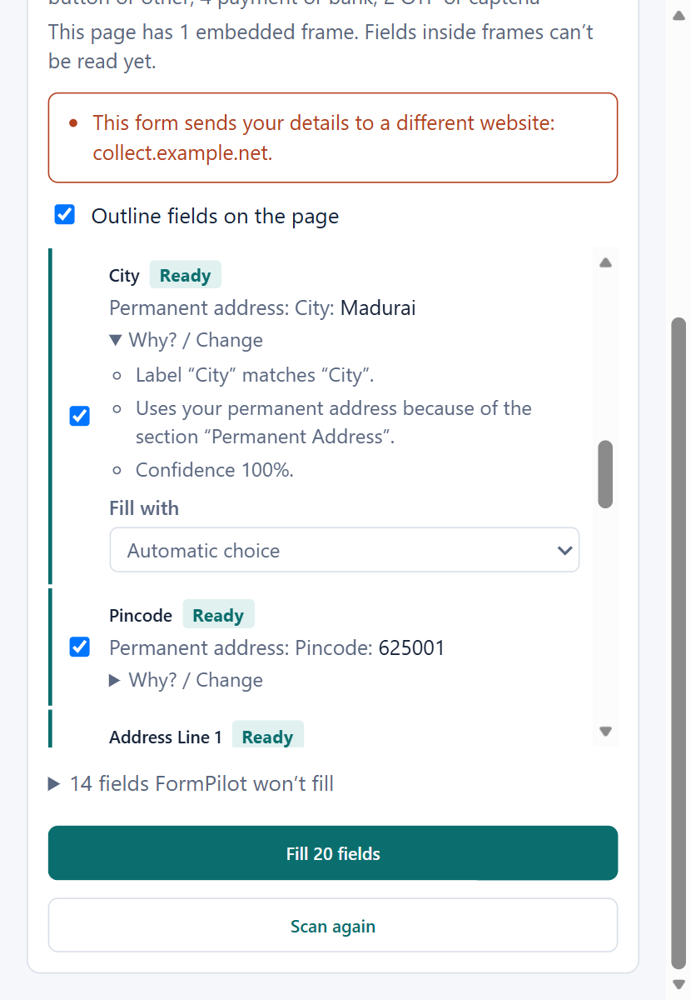
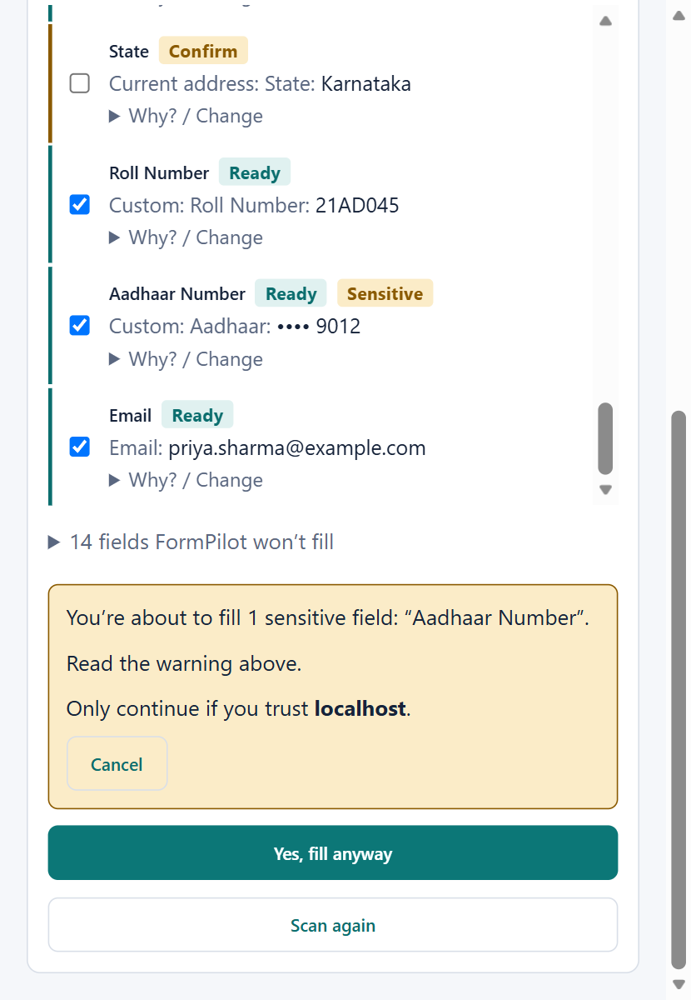

# FormPilot

**Understand any form. Fill it intelligently.**

FormPilot is a Chrome/Edge extension that reads a web form, works out what each field is asking for, and fills it from a profile you saved, but only after you review and approve it.



## Features

- **Reads messy forms**: missing labels, table layouts, styled radio buttons, fields inside web components.
- **Understands context**: "City" under *Permanent Address* and "City" under *Current Address* get different values. An *Emergency Contact* section is never filled with your details.
- **Explains every match**: each field shows a confidence badge (**Ready**, **Confirm**, or **Not sure**) and a "Why?" list. When FormPilot isn't sure, it asks instead of guessing.
- **Formats values for the field**: dates in the format the form asks for, the right dropdown/radio option, phone numbers trimmed to fit.
- **Learns from you**: change a match once and FormPilot remembers it for that site.
- **Notices new fields** that appear while the popup is open.

## Privacy and security

- Your profiles are **encrypted** with your passphrase (AES-GCM-256, key from PBKDF2-SHA256 with 600,000 rounds) and stored only in your browser. Nothing is sent anywhere.
- FormPilot locks when you close the browser, after 15 minutes without use, or when you click **Lock**. If you forget your passphrase, your data can't be recovered.
- It **never fills** passwords, card or bank details, OTPs, captchas, or checkboxes, and it **never submits** a form.
- It **never fills hidden fields**, a trick some pages use to collect extra data. Visibility is checked again right before filling.
- Sensitive fields (Aadhaar, PAN, passport…) and risky pages (no https, a form that sends data to another site, a suspicious web address) need an extra confirmation click.
- Permissions: `activeTab`, `scripting`, `storage` only. FormPilot can only see a page after you click its icon.

## Install

You need [Node.js](https://nodejs.org/) 20 or newer.

```bash
git clone <your-repo-url>
cd formpilot
npm install
npm run build
```

Then load it in Chrome or Edge:

1. Open `chrome://extensions` (or `edge://extensions`).
2. Turn on **Developer mode**.
3. Click **Load unpacked** and select the `dist/` folder.

## How to use

1. Click the FormPilot icon (or press **Alt+Shift+F**).
2. The first time, set a passphrase, then create a profile with your details in the page that opens.
3. On any form, open FormPilot and click **Scan this page**.
4. Review the list. **Ready** fields are ticked for you; tick **Confirm** fields yourself if they look right. Use **Why? / Change** to see the reasoning or pick a different value.
5. Click **Fill**, check the page, and submit the form yourself.

## Screenshots

| Analysis | Explanation | Sensitive field |
|---|---|---|
|  |  |  |

More in [`docs/screenshots/`](docs/screenshots/). All screenshots use a made-up demo profile.

## Development

| Command | What it does |
|---|---|
| `npm run dev` | Rebuild into `dist/` on every change (then click reload on the extension) |
| `npm run build` | Type-check and build into `dist/` |
| `npm test` | Run the unit tests |
| `npm run typecheck` | Type-check only |
| `npm run test-forms` | Serve a test page with tricky forms at http://localhost:5500 |

The test page (`test-forms/index.html`) says what FormPilot should do in each section, which makes it easy to check changes by hand.

### Project layout

```
public/manifest.json    Extension manifest
src/popup/              Popup UI (React): scan, review, fill
src/options/            Options page (React): profiles, corrections, security
src/content/            Runs in the web page: finds fields, fills them
src/intelligence/       Matching logic: normalizing, synonyms, context, confidence
src/security/           Encryption and risky-page warnings
src/storage/            The only code that touches browser storage
src/profiles/           Profile data model and validation
```

## Tech stack

**Platform and browser APIs** (built in, nothing to install)

| What | Used for |
|---|---|
| Chrome Extensions, Manifest V3 | Popup, options page, service worker, content script |
| `chrome.scripting`, `chrome.tabs` | Injecting the content script and messaging the page |
| `chrome.storage` (local + session) | Encrypted profiles on disk; the unlock key in memory only |
| Web Crypto API | AES-GCM encryption and PBKDF2 key derivation |
| MutationObserver | Noticing fields that appear after the scan |

**Runtime libraries** (shipped inside the extension)

| Library | Version | Used for |
|---|---|---|
| [React](https://react.dev/) | 19.3 | Popup and options page UI |
| React DOM | 19.3 | Rendering React into the pages |

**Development tools** (used to build and test; not shipped)

| Tool | Version | Used for |
|---|---|---|
| [TypeScript](https://www.typescriptlang.org/) | 7.0 | Language and type checking |
| [Vite](https://vite.dev/) | 8.3 | Building the extension into `dist/` |
| @vitejs/plugin-react | 6.1 | JSX support in Vite |
| [Vitest](https://vitest.dev/) | 5.0 | Unit tests |
| concurrently | 10.0 | Running both watch builds in `npm run dev` |
| @types/chrome, @types/react, @types/react-dom | — | Type definitions for the Chrome and React APIs |

React is the only third-party code that ships in the extension. The form matching and filling logic is the project's own code, and encryption uses the browser's built-in Web Crypto rather than a crypto library.

## Known limitations

- Fields inside iframes aren't read.
- A field covered by another element isn't detected as hidden.
- Encryption protects your data at rest and while locked. It can't protect against malware running on your computer while FormPilot is unlocked.
